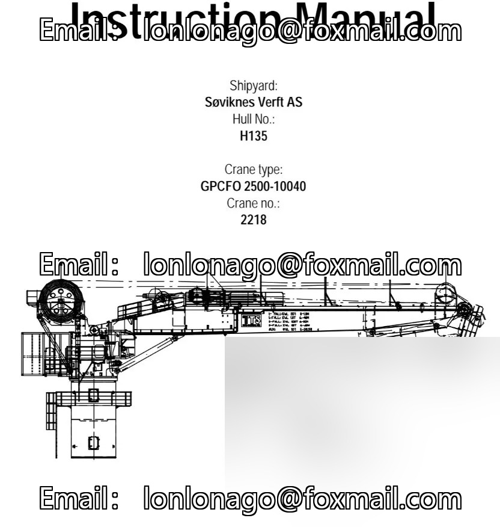
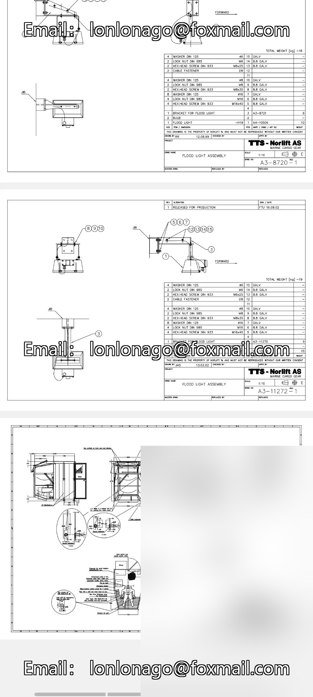
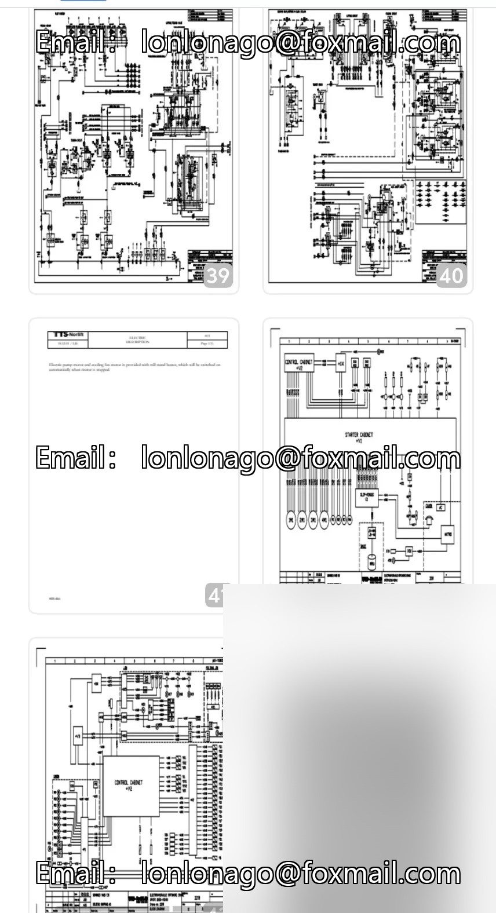
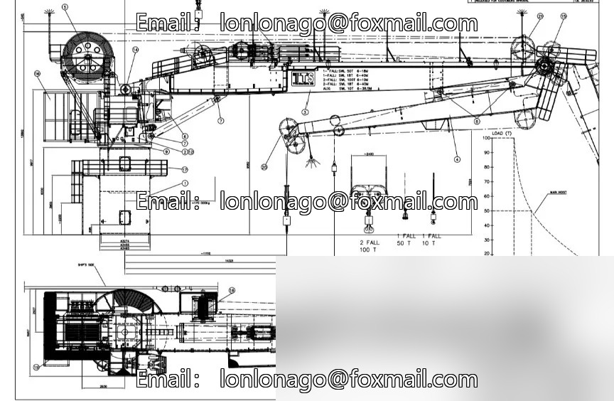
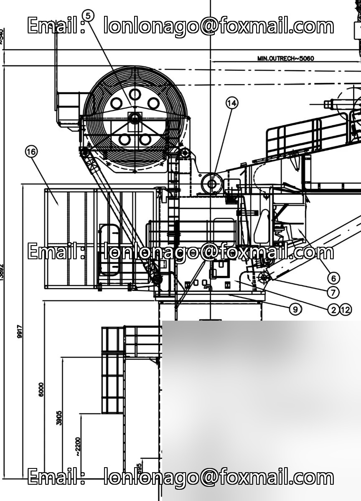

# TTS Marine ASA ship-type crane

## Body

TTS Marine ASA Ship's Crane (Marine Crane) Operation and Maintenance Manual
PDF , 330 pages
Equipment Manufacturer: TTS Marine ASA, a major Norwegian offshore equipment company, headquartered in Bergen
Installation Shipyard: Søviknes Verft AS, a Norwegian shipyard, Hull no. H135
Electronic PDF, content covers operation procedures, maintenance and service, system principles, etc., suitable for equipment technical personnel reference.
Photograph directly, contact privately for any issues.
0316

The document covers the Marine Crane operating and maintenance manual in PDF format, including operation processes, maintenance, and system principles, with details such as the manufacturer, installation yard, and model.

<!-- AI_ENRICHED -->

## Images

## Payment

Here is a pay link on Stripe ( https://buy.stripe.com/3cs8yP7sY87d0vu9AB ). Please contact me lonlonago@foxmail.com after funding $89, and I will send you a complete data files , thank you!

